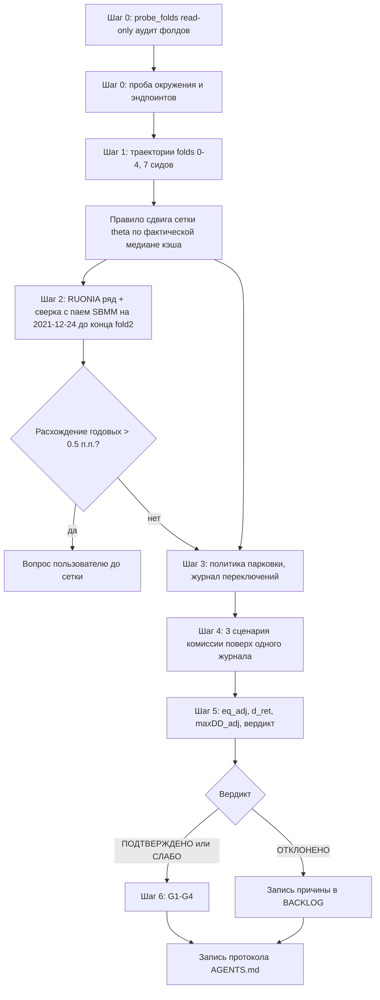

# План исполнения: parking_exp_v0.3 (парковка кэша, слой L3 без брокера)

Статус: согласовано с пользователем 2026-10-30. Основа — ТЗ parking_exp_v0.2
ревизия 2 + правки по сверке с кодом (N1–N10) + правки ревизии 3 по аудиту
фолдов + решения пользователя (подкласс ParkingEvalEnv; N8 — решающее
правило mean d_ret > 0).

Имя файла сохранено (`v0_2`) ради непрерывности; содержательно это ревизия 3.

Предмет эксперимента: арифметика политики парковки на исторических
траекториях кэша агента v1.2. НЕ качество агента (in-sample статус окон
фиксируется фактической таблицей из шага 0; честная проверка — тень L4/L5).
Fold 5 (holdout) не используется ни в каком виде. Обучение не запускается.

## Правки ревизии 3 (по аудиту фолдов)

- **R3.1. Статус fold2 = ПОЛНОСТЬЮ in-sample.** В v0.2 было «in-sample
  частично» — исправлено. Доказательство не зависит от `ep_start`:
  `train_fold5 = [1855, 3055)`; при `step >= 400` имеем
  `vs(fold2) = ep_start + 2*step + 1205 >= 2005 > 1855`, то есть
  test-окно fold2 целиком лежит внутри train-окна fold5.
  Итог: **folds 0–1 — OOS, folds 2–4 — полностью in-sample.**
- **R3.2. Таблица статусов окон — ПОДТВЕРЖДЕНА прогоном `probe_folds.py`
  2026-10-30** (датасет 3161 строка, 2014-08-19 .. 2026-10-02;
  `ep_start=9`, `step=435`; `train fold5 = [1855,3055)` =
  2021-12-24 .. 2026-06-10):

  | fold | train [ts,te) | train даты (вкл) | test [vs,ve) | test даты (вкл) | строк test | в train fold5 | статус |
  |---|---|---|---|---|---|---|---|
  | 0 | [9,1209) | 2014-09-01 .. 2019-06-05 | [1214,1314) | 2019-06-14 .. 2019-10-31 | 100 | 0 | OOS |
  | 1 | [444,1644) | 2016-05-30 .. 2021-02-26 | [1649,1749) | 2021-03-09 .. 2021-07-27 | 100 | 0 | OOS |
  | 2 | [879,2079) | 2018-02-15 .. 2022-12-09 | [2084,2184) | 2022-12-19 .. 2023-05-12 | 100 | 100 | IN-SAMPLE |
  | 3 | [1314,2514) | 2019-11-01 .. 2024-08-27 | [2519,2619) | 2024-09-04 .. 2025-01-24 | 100 | 100 | IN-SAMPLE |
  | 4 | [1749,2949) | 2021-07-28 .. 2026-02-18 | [2954,3054) | 2026-02-24 .. 2026-06-09 | 100 | 100 | IN-SAMPLE |
  | 5 | [1855,3055) | 2021-12-24 .. 2026-06-10 | [3060,3161) | 2026-06-16 .. 2026-10-02 | 101 | 0 | OOS (holdout) |

  Вывод: folds 0–1 — OOS; folds 2–4 — ПОЛНОСТЬЮ in-sample (по 100/100);
  fold 5 — единственное полностью чистое окно, израсходовано, не используется.
- **R3.3. Зона сверки с паем SBMM: 2021-12-24 .. 2026-06-09** (непрерывный
  диапазон существования пая, folds 2–4 test-окна целиком внутри).
  folds 0–1 в сверку не входят: fold 1 заканчивается 2021-07-27, до старта
  пая 2021-12-24.
- **R3.10 (НОВАЯ, поправка к R3.4). Ставки на folds 0–1 НЕ «7–20%».**
  Фактически: fold 0 (2019-06..10) — ~7.5% годовых; fold 1 (2021-03..07) —
  ~4.25–6.0% годовых. Прямое следствие для интерпретационного теста:
  при ставке 4.5% и round-trip комиссии 0.08% окупаемость парковки ~7 дней,
  поэтому ОТРИЦАТЕЛЬНЫЙ `d_ret` на fold 1 — НЕ обязательно баг политики,
  а возможное честное следствие низкой ставки при частых переключениях.
  - fold 0 (7.5%): строгий тест применим — отрицательный `d_ret` при
    медиане кэша выше theta трактуется как сигнал о БАГЕ политики;
  - fold 1 (4.25–6.0%): нейтральная зона — отрицательный `d_ret`
    допускается как экономический результат, не как баг.
- **R3.4. Интерпретационный тест (решающее правило НЕ меняет).**
  ИСХОДНАЯ формулировка («folds 0–1 — ставки 7–20%, отрицательный `d_ret`
  = баг политики») ОТМЕНЕНА как неверная по факту. Действующая версия —
  R3.10 выше: строгий тест только для fold 0 (~7.5%), fold 1
  (4.25–6.0%) — нейтральная зона.
- **R3.5. Порядок запуска:** `probe_folds.py` -> шаг 1 (траектории) ->
  выбор сетки. Правило сдвига сетки (N7) применяется ТОЛЬКО по фактической
  медиане кэша из шага 1, не по оценке.
- **R3.6. Вывод `probe_folds.py`:** печатаются даты train-окна fold5;
  даты печатаются как `te-1 (вкл)`, потому что граница `te` эксклюзивна.
- **R3.7. Разрешение на прогон `probe_folds.py`:** read-only, на диск не
  пишет, env не инстанцирует, базу Optuna не открывает. Соответствует
  разделу «не трогать»; отдельного разрешения F2 НЕ требует.
- **R3.8. Запуск строго в окружении `trading-agent`** (активация conda
  обязательна — прямой `python.exe` ломает LAPACK).
- **R3.9. Комментарий `~3.3 года` в `portfolio_env.py:43`** — микропункт
  бэклога, сейчас не трогать.

## РЕЗУЛЬТАТЫ ШАГА 0 (пробы 1–6, выполнены 2026-10-30, read-only)

Пробы `probe_folds.py`, `probe_env.py`..`probe_env6.py`. Ни одна не писала
на диск, не открывала базу Optuna, не создавала PortfolioEnv.

### Окружение (probe_env.py)
python 3.12.14; pandas 3.0.6, numpy 1.26.4, requests 2.34.2,
matplotlib 3.11.2, stable_baselines3 2.9.0 — есть.
**ОТСУТСТВУЮТ: openpyxl, lxml, bs4, html5lib.** Каталог `logs/` есть,
`data/` и `results/` ОТСУТСТВУЮТ -> скрипты создают их сами
(`os.makedirs(..., exist_ok=True)`).

### Кодировка консоли
Windows cmd в cp866 ломает UTF-8 вывод (ромбики). Конвенция для всех
скриптов эксперимента:
  - запуск: `chcp 65001 >nul && set PYTHONIOENCODING=utf-8 && <activate> && python ...`;
  - в скрипте: `sys.stdout.reconfigure(encoding="utf-8")` в try/except;
  - запись лога: `open(..., encoding="utf-8")` ЯВНО.

### Источник ставки — RUSFAR вместо RUONIA (отклонение от F1)
Перебор источников:
  | источник | результат |
  |---|---|
  | `/hd_base/ruonia/` GET и POST | HTML, даты периода НЕ применяются, таблица транспонирована, данные в JS -> нужен парсинг HTML |
  | `XML_ruonia.asp` | 404 (мёртв) |
  | `XML_dynamic.asp` | жив, но пустой под 7 проверенными кодами |
  | `XML_dynamic` RURKEYRATE | пусто |
  | **MOEX ISS `history/.../RUSFAR.json`** | **РАБОТАЕТ**: JSON, BOARDID=MMIX, CLOSE = % годовых |

RUSFAR выбран потому, что: (а) JSON через уже проверенный пайплайн —
новых зависимостей ноль; (б) история с **2019-01-09**, покрывает fold 0
(тест с 2019-06-14); (в) сверен с реальным паем SBMM.

### Сверка RUSFAR−TER против пая SBMM (probe_env6.py)
На ОДИНАКОВЫХ 150 датах (2022-06-01 .. 2022-12-29):
  RUSFAR средняя = 8.0627% годовых;  RUSFAR − TER = 7.7327%;
  пай SBMM фактически = 7.7719% годовых;
  **РАЗНИЦА = −0.0392 п.п. годовых** -> в пределах порога 0.5, прокси валиден.
(Ранняя оценка «+0.2547» была артефактом разных окон — см. N11.)

### Пагинация MOEX ISS — КРИТИЧНО (N11)
`/iss/history/...` отдаёт **максимум 100 строк на страницу**.
  - RUSFAR 2019: 3 страницы, 244 строки, `cursor.TOTAL=244` — СОВПАЛО;
  - RUSFAR 2022: 2 страницы, 150 строк, `cursor.TOTAL=150` — СОВПАЛО.
**Требование:** любой забор истории обязан листать `start=<offset>` до
страницы короче 100 строк И сверять итог с `history.cursor.TOTAL`.
Без этого ряд молча обрывается и результат неверен.

### SBMM: фактический старт и аномалии (probe_env6.py)
- факт старт торгов пая: **2021-10-05** (раньше прежней оценки 2021-12-24);
- 500 свечей в окне 2021-10-05..2023-10-25;
- **отрицательных дней 73 из 500** (не «единичные»): почти все мелкие
  (−0.01…−0.07%, округление цены до тика), но есть −0.6836% (2021-12-27)
  и −0.3814% (2022-01-04);
- **гэпов > 2 п.п. — 2, оба на приостановке торгов MOEX:**
  2022-02-24 −2.8552% и 2022-02-25 +2.5692%.
  Это известный «мост» (AGENTS.md), а не глюк котирования.

### РЕЗУЛЬТАТЫ ШАГА 1 (parking_eval_seeds.py, 2026-10-30 21:52)

Факт прогона, все гейты пройдены:
- лидер сверен: trial 14, mw=0.55, λhhi=0.002276, ts=250000, dd_alpha=8.379367,
  γ=0.998, ep=4; направление study = MAXIMIZE; база открыта read-only;
- obs_dim=56, слотов весов 7, нормализация заморожена по fold5 train
  idx [1855,3055) 2021-12-24..2026-06-10 (вкл), 1200 строк;
- 35 траекторий (7 сидов x 5 фолдов), QC эквити: **все 35 rel=0.00e+00 OK**.

| fold | cash_mean | cash_med | cash_min | cash_max | ret %  | eq %   | turn  |
|------|-----------|----------|----------|----------|--------|--------|-------|
| 0    | 0.249     | 0.283    | 0.081    | 0.458    | +3.45  | +5.40  | 0.1667 |
| 1    | 0.212     | 0.237    | 0.053    | 0.510    | −1.70  | −1.50  | 0.1869 |
| 2    | 0.210     | 0.213    | 0.053    | 0.514    | +22.12 | +25.54 | 0.1804 |
| 3    | 0.160     | 0.148    | 0.023    | 0.422    | +19.75 | +15.65 | 0.2650 |
| 4    | 0.220     | 0.205    | 0.050    | 0.508    | −9.61  | −10.88 | 0.2011 |

**N7 СРАБОТАЛ: медиана кэша > 0.12 на ВСЕХ пяти фолдах** (0.148 .. 0.283).
-> действует СДВИНУТАЯ сетка `theta=(0.08, 0.15, 0.25)`, 9 валидных пар,
945 ячеек. Базовая сетка (6 пар / 630 ячеек) не применяется.

Три дефекта найдены и исправлены В ПРОЦЕССЕ (ревизия 5):

1. **`info["portfolio_ret"]` — это НАГРАДА, а не доходность.**
   В [`portfolio_env.py:228`](portfolio_env.py:228) ключ получает `reward`
   (`net_ret - dd_penalty - hhi_penalty`), но назван `portfolio_ret`.
   Первый прогон восстанавливал эквити из наград -> QC FAIL 35/35.
   Исправление: `net_ret = pv(t)/pv(t-1) - 1` из самой эквити среды.

2. **Длина траектории в eval — 99 строк, а не 100.**
   [`portfolio_env.py:246`](portfolio_env.py:246):
   `ep_length = *_end - start_idx - 1` -> 1314-1214-1 = 99.
   Это норма среды; ожидание исправлено на `ve - vs - 1`.

3. **Ловушка cmd: `PARKING_EXP_AUTO` приходит как `"1 "` с пробелом.**
   `set VAR=1 && python ...` включает пробел перед `&&` в значение
   (проверено: `PY_VAR=[1 ]`). Строгое `== "1"` не срабатывало и
   безголовый запуск молча отменялся. Исправление: `strip().lower()`.

Также найдено: файлы моделей лежат **без расширения `.zip`** (внутри
валидный zip SB3, magic `PK\x03\x04`). Резолвер `model_path()` проверяет
оба варианта, как гейт [`stage2_only_v1_2.py:474`](stage2_only_v1_2.py:474).

Интерпретационный контекст для вердикта: fold 1 даёт отрицательный `d_ret`
ещё до расчёта парковки, а базовая доходность агента на fold 1 = −1.70%
против Equal −1.50% — это нейтральная зона (ставка 4.25-6.0%), а НЕ баг политики.

### РЕЗУЛЬТАТЫ ШАГА 2 (parking_fund_rate.py, 2026-10-30 22:2x)

- RUSFAR: **1900 строк, 2019-01-09 .. 2026-10-02**, пагинация сверена с
  `history.cursor.TOTAL` (1900 == 1900). Средняя за период 10.9607% годовых.
- SBMM: **1208 свечей, 2021-10-05 .. 2026-06-19** (после 2026-06-19 котировок
  нет; fold 4 заканчивается 2026-06-09, покрытие достаточно).
- Гейт покрытия fold 0 (N14): первая дата RUSFAR 2019-01-09 раньше старта
  теста fold 0 (2019-06-14) — [OK].
- Гейт гэпов пая (N12 гибрид): аномалии > 2 п.п. только 2022-02-24/25,
  обе покрыты fallback-множеством — [OK]. Мелкие отрицательные дни
  (|r| < 0.1%) — 73 из 500 на первом окне, только заметка, не стоп.
- **Сверка ставки с паем: −0.9529 п.п. годовых -> WARN** (решение
  пользователя: порог 0.5 переведён в WARN). Причина структурная и
  зафиксирована в `RATE_VS_FUND_REASON`: RUSFAR — овернайт, фонд держит
  РЕПО длиннее суток; на крутой кривой фонд доходнее. Расхождение растёт
  со ставкой: 2021 −0.42, 2022 −0.88, **2023 −0.04**, 2024 −1.43,
  2025 −2.18, 2026 −1.43 п.п. Смещение в безопасную сторону: расчёт по
  RUSFAR−TER **занижает** выгоду парковки, то есть базовый сценарий —
  консервативная нижняя граница.
- Два сценария ставки (решение пользователя): `base` = RUSFAR − TER и
  `upper` = фактическая доходность пая. В окне существования пая:
  `upper` 13.4676% против `base` 12.5074% годовых -> **+0.9603 п.п.**
  Артефакт: `data/r_fund_scenarios.csv` (3161 строка, обе колонки;
  покрытие `upper` 1204 строки, остальные 1957 заполняются базой).

### РЕЗУЛЬТАТЫ ШАГА 3 (parking_grid.py, 2026-10-30 22:27)

Сетка 9 конфигураций x 3 комиссионных сценария x 5 фолдов x 7 сидов
= 945 ячеек, 135 агрегированных строк в `results/parking_grid.csv`.

Кассовый вердикт (сценарий x1.0, комиссия 0.04%/операцию):
**ПОДТВЕРЖДЕНО на всех 9 конфигурациях** (mean d_ret > 0 в 5/5 фолдах,
хвостовой барьер −0.1 п.п. не пробит нигде).

| theta/floor | mean d_ret, п.п. | фолдов>0 | худший фолд | fold 0 (строгий) |
|---|---|---|---|---|
| **0.08/0.01** | **+0.5255** | 5/5 | +0.1927 | +0.4394 [OK] |
| 0.08/0.02 | +0.4913 | 5/5 | | |
| 0.08/0.04 | +0.4203 | 5/5 | | |
| 0.15/0.01 | +0.5082 | 5/5 | | |
| 0.15/0.02 | +0.4737 | 5/5 | | |
| 0.15/0.04 | +0.4039 | 5/5 | | |
| 0.25/0.01 | +0.3336 | 5/5 | +0.1286 | +0.3736 [OK] |
| 0.25/0.02 | +0.3136 | 5/5 | | |
| 0.25/0.04 | +0.2662 | 5/5 | | |

Лучшая по N5: **theta=0.08 / floor=0.01**. Комиссионная чувствительность:
x0.0 +0.6867, x1.0 +0.5255, **x2.0 +0.3645 п.п.** (5/5 фолдов во всех
сценариях — при удвоении тарифа знак не меняется).

**Верхний сценарий ставки монотонно повышает `d_ret` при неизменной
траектории кэша (политика не зависит от `r_fund`); контрольная точка
best-config: +0.5287 п.п. Вердикт устойчив к обоим сценариям.**
Полный прогон сетки на upper сознательно НЕ делался — достаточно
контрольной точки по лучшей конфигурации (решение пользователя
2026-10-30).

Структурная закономерность: чем ниже `floor`, тем выше d_ret —
политика выгоднее, когда паркуется больший объём; чем выше `theta`,
тем меньше сделок и слабее эффект (0.25 даёт вдвое меньше операций
и на 40% меньше выгоды).

### РЕВИЗИЯ 5: дефекты, найденные при прогонах шагов 3 и 6

4. **Формула eq_adj в первой реализации была неверной.** Считался
   только парковочный множитель `Π(1 + held·r_fund − cost)`, а затем
   `d_ret = eq_adj/base − 1`, то есть отношение парковочного множителя
   к доходности акций — величина без смысла. Исправлено: парковочный
   вклад АДДИТИВЕН к доходности агента (кэш в базовой эквити дохода
   не приносит):
   `eq_adj(t) = eq_adj(t−1) × (1 + net_ret(t) + held(t)·r_fund(t) − costs(t))`.

5. **Инвариант E5 падал на реальных данных — и это было содержательно.**
   Первый прогон упал: `fund_pos=0.2710 > cash=0.2675` на fold 1
   (2021-05-10). Причина: заявка, отложенная с неторгового дня,
   исполняется по СТАРОМУ объёму, а агент к этому моменту уже вложил
   часть кэша в акции — он о парковке не знает. Трактовка исправлена:
   это не баг реализации, а физический **вынужденный выкуп**. Теперь
   объём исполнения ограничивается текущим кэшем (`min(want, cash)`),
   выкуп оплачивается комиссией и считается отдельной метрикой
   `forced_buybacks` (в среднем 2.6–3.9 за окно). Жёсткая проверка
   инварианта сохранена как страховка и не срабатывает.

6. **`model_path()` не находил `.zip`** (см. выше, шаг 1) — повторено
   для полноты, повлияло на все шаги.

**Проверка тарифа комиссии (уточнение пользователя, N16).** Комиссия
брокера — ТОЛЬКО процент от объёма, **абсолютной ставки за поручение
НЕТ**. Значит дробление одной перестановки на мелкие части не удорожает,
и мёртвая зона на объём сделки (deadband) экономически не обязательна.
Политика оставлена по ТЗ (`band = 0`). Диагностика `probe_deadband.py`
(theta=0.08/floor=0.01) показывает, что вердикт от deadband не зависит:

| band | mean d_ret, п.п. | операций за 99 дней | фолдов>0 |
|---|---|---|---|
| 0 (по ТЗ) | +0.5255 | 90 | 5/5 |
| 0.5% | +0.5263 | 82 | 5/5 |
| 1% | +0.5287 | 74 | 5/5 |
| 2% | +0.5353 | 57 | 5/5 |
| 5% | +0.5361 | 30 | 5/5 |

Высокая частота (77–92 операции за 99 шагов) — честное следствие того,
что `target = cash − floor` ежедневно дрейфует вместе с долей кэша.
При пропорциональной комиссии затраты зависят только от суммарного
оборота (`cost_mean = 0.00146` = 0.146% NAV за окно), а он учтён
корректно. Параметр в конфиг НЕ вводится; число операций печатается
как справочная характеристика режима.

### РЕЗУЛЬТАТЫ ШАГА 6 (parking_plots.py, 2026-10-30 22:36)

Записаны 4 графика: `results/parking_heatmap.png` (G1, три панели по
floor, невалидные пары серые), `parking_equity.png` (G2, эквити агента
против eq_adj на худшем и лучшем фолде), `parking_cash.png` (G3, кэш и
позиция в фонде с отметками theta/floor и числом вынужденных выкупов),
`parking_commission.png` (G4, d_ret против множителя комиссии по всем
9 конфигурациям). Скрипт переиспользует функции политики из
`parking_grid.py`, поэтому картинки не могут разойтись с вердиктом.

### РЕШЕНИЯ ПОЛЬЗОВАТЕЛЯ по итогам шага 0 (2026-10-30, ревизия 4)

**F1 ОБНОВЛЁН: источник ставки — RUSFAR (MOEX ISS), а не RUONIA.**
RUONIA с ЦБ недоступна без HTML-парсинга (XML_ruonia.asp = 404,
XML_dynamic.asp пуст под 7 кодами, GET/POST не применяют период,
данные в JS). RUSFAR: JSON, история с 2019-01-09, сверен с паем
SBMM на 150 общих датах -> −0.0392 п.п. годовых. Зависимости не нужны.

**N12. Гейт гэпов пая — ГИБРИД (правило + явный fallback).**
Проверено `probe_gap.py`: в датасете ОДИН разрыв > 10 дней —
`2022-02-25 -> 2022-03-24` (27 дн.). Позиции аномалий:
  - `2022-02-25`: внутри разрыва (после неё 27 дн.) -> покрывается правилом;
  - `2022-02-24`: **ВНЕ разрыва** (2 дн. до, 1 дн. после) -> правилом НЕ покрыт.
Правило одно даёт только частичное покрытие, поэтому действует гибрид:
  гэп пая > 2 п.п. НЕ является ошибкой, если
  (а) дата совпадает с разрывом календаря датасета (> GAP_DAYS=10 дней), ЛИБО
  (б) дата входит в явный fallback-список `{2022-02-24, 2022-02-25}`.
Прочие гэпы > 2 п.п. — стоп с ошибкой. Оба механизма в parking_config.py,
причина каждой поблажки печатается в лог построчно.
Интерпретация: 24-02 — реальное падение, 25-02 — реальный отскок перед
приостановкой торгов, а не глюк котирования.

**N13. Порог «мелкого» отрицательного дня пая: |r| < 0.1%.**
Факт: 73 отрицательных дня из 500 (не «единичные»), почти все мельче
0.1% (округление цены до тика), но есть −0.6836% (2021-12-27) и
−0.3814% (2022-01-04) — они печатаются как [WARN], но НЕ стоп.

**N14. Обязательное подтверждение покрытия fold 0.**
До расчёта ставки скрипт шага 2 проверяет: первая дата RUSFAR (2019-01-09)
<= начало test-окна fold 0 (2019-06-14). Не выполняется — стоп с ошибкой.
Факт и вердикт печатаются в лог.

**N15. Допуск в правиле валидности (float-баг, поймано самопроверкой).**
Первая версия `is_valid_pair` дала 7 конфигураций / 735 ячеек вместо 6 / 630.
Причина — арифметика float: `0.05 - 0.04 = 0.010000000000000002 > 0.01`
-> True, пара ровно на границе ошибочно валидна. `0.03 - 0.02 =
0.009999999999999998` -> False (корректно). Исправлено допуском:
`(theta - floor) > (MIN_PARK_VOL + VALIDITY_EPS)`, `VALIDITY_EPS = 1e-9`.
После правки: базовая сетка 6 / 630, сдвинутая 9 / 945 — совпало с ТЗ.
То же сравнение обязан использовать `parking_grid.py` (импорт из конфига,
не дублировать формулу).

## Зафиксированные технические конвенции (без развилок)

### N1. Гиперпараметры лидера передаются явно
- `optuna_ppo_v1_2.db` / study `ppo_v1.2` читается СТРОГО read-only
  (URI `mode=ro&uri=true`, рецепт `stage2_only_v1_2.py`, включая fallback
  на копию базы во временной папке при WAL).
- Из `study.best_trial` берутся фактические `max_weight`, `lambda_hhi`,
  `dd_alpha` (ожидание: mw=0.55, λhhi=0.0023, dd_alpha=8.38).
- Все параметры передаются в конструктор env ЯВНО; дефолт
  `max_weight=0.5` не допускается — `_apply_cap()` перекладывает избыток
  в кэш, поэтому cap 0.50 вместо 0.55 систематически завышает кэш и
  смещает результат В ПОЛЬЗУ парковки.
- Гейты до прогона: направление study = MAXIMIZE (иначе стоп);
  `obs_dim == 56` (иначе стоп); фактические `max_weight` печатаются в лог.
  При расхождении с ожидаемым — [WARN] и продолжение по фактическим.

### N2. Формула r_fund на строку датасета (выходные сессии учтены)
`r_fund(шаг t) = Σ по календарным дням d ∈ (date(t); date(t+1)]`
`                [ RUONIA(d)/365 − TER/365 ]`, TER = 0.0033.
- Начисление аддитивное по календарным дням: за год выходит ровно ставка
  минус TER, независимо от плотности строк датасета (в фичах есть
  выходные сессии — см. `weekend` в `candles_full.csv`).
- Выходные/праздники: ставка forward-fill последнего рабочего значения;
  начисление за 2–4 календарных дня приходит на первом шаге после них —
  это соответствует реальному РЕПО O/N.
- Для последней строки окна `r_fund` не нужен (шага нет).
- Значения RUONIA интерпретируются как % годовых -> делятся на 100
  до деления на 365; проверка коридора [0; 40]%.

### N3. Определение торгового дня (для ограничения тени)
- Торговый день = дата присутствует в ряду RUONIA (ЦБ публикует только
  в рабочие дни) И присутствует в индексе датасета.
- Никаких `dayofweek < 5`: 1–8 января и прочие праздники не должны
  приводить к фиктивным перестановкам.
- Решение агента в неторговый день -> перестановка откладывается до
  ближайшего торгового дня, в журнале строка `pending`.

### N4. Индексация начисления в eq_adj
- `held(t)` = `fund_pos` ПОСЛЕ исполнения перестановки шага t (позиция,
  которая удерживается на протяжении шага t -> t+1).
- Доход шага t: `held(t) × r_fund(t)`, где `r_fund(t)` — сумма за
  календарные дни `(date(t); date(t+1)]`. Это выполняет конвенцию
  «куплено в день t -> доход начиная с t+1» без сдвига на день.
- Комиссия `costs(t)` списывается в шаге t, на объём перестановки
  `|target_fund(t) − fund_pos(t−1)|`.
- Рекуррентно: `eq_adj(t) = eq_adj(t−1) × (1 + held(t)×r_fund(t) − costs(t))`,
  `eq_adj` стартует с `eq(0)=1.0`.
- Погрешность аддитивной аппроксимации (~cash × r_agent × r_fund,
  <0.01% за окно) печатается в лог как пренебрежимая.

### N5. Правило выбора лучшей конфигурации (фиксируется ДО прогона)
`best = argmax mean d_ret` при сценарии x1.0 по всем 5 фолдам и 7 сидам.
Tie-break: меньше суммарных переключений, затем меньше theta.
Используется в G2 и G4; после прогона не пересматривается.

### N6. Заморозка нормализации fold5 — подкласс, env не трогаем
- `portfolio_env.py` НЕ ПАТЧИТСЯ вообще (дифф = ноль).
- В `parking_eval_seeds.py` объявляется
  `class ParkingEvalEnv(PortfolioEnv)`: после `super().__init__()`
  подменяет `self.feat_mean` / `self.feat_std` статистиками train-окна
  fold 5 (`features.iloc[ts5:te5]`, те же формулы, что в
  `portfolio_env.py:132-134`).
- Причина: модели v1.2 обучены на статистиках fold5; при создании env с
  `fold=k` obs нормализуется по train-окну fold k -> рассинхрон со входом
  модели -> политика мусорная.
- Критерий «байт-в-байт для обучения» выполняется тривиально: тренировочный
  код не изменён; проверка — `git diff portfolio_env.py` пуст.

### N7. Правило сдвига сетки (единая сетка на все фолды)
- Триггер: медиана кэша хотя бы по одному фолду > 0.12. Считается ТОЛЬКО
  по фактическим траекториям шага 1 (см. R3.5), не по оценкам.
- Сдвиг применяется ОДНИМ решением ДО прогона сетки, ко ВСЕМ фолдам.
- Число валидных конфигураций и ячеек ПЕРЕСЧИТЫВАЕТСЯ по тому же правилу
  `theta − floor > 0.01`. Пример: θ∈{0.08,0.15,0.25}, floor∈{0.01,0.02,0.04}
  -> все 9 пар валидны -> 9 конфигураций × 3 сценария × 7 сидов × 5 фолдов
  = 945 ячеек (а не 6/630).
- Базовая сетка: θ∈{0.03,0.05,0.10}, δ∈{0.00,0.02,0.03},
  floor∈{0.01,0.02,0.04}, 6 валидных пар, 630 ячеек.
- После прогона сетку не менять.

### N8. Вердикт: решающее правило и хвостовой барьер
- РЕШАЮЩЕЕ: `mean d_ret > 0` после комиссий (базовый x1.0) в >= 4 из 5
  фолдов по среднему по сидам.
- ХВОСТОВОЙ БАРЬЕР: ни в одном фолде среднее не хуже −0.10 п.п.
  Ограничение фиксируется рядом в ТЗ и в логе: барьер лежит ВНУТРИ шума
  прокси. **Уточнение N8 (ФАКТ, 2026-10-30):** фактическая сверка RUSFAR
  против пая SBMM (шаг 2) показала расхождение −0.9529 п.п. годовых против
  оценки ±0.5 п.п./год, принятой при формулировке барьера. Это соответствует
  шуму прокси до **±0.27 п.п. на 100-дневное окно** (ранее оценивали
  ±0.14 п.п.). Хвостовой барьер −0.10 п.п. целиком внутри фактического
  шума прокси: он защищает только от катастрофических хвостов, решающее
  правило — `mean d_ret > 0`. Учитывать при любом дальнейшем цитировании
  вердикта.
- ИНТЕРПРЕТАЦИОННЫЙ ТЕСТ (R3.4, решающее правило не меняет): folds 0–1 —
  ставки 7–20% годовых; положительный `d_ret` там обязателен даже при
  низком кэше. Отрицательный `d_ret` на folds 0–1 = сигнал о баге политики.
- СЛАБО: положительно на 2–3 фолдах — анализ корреляции с уровнем кэша.
- ОТКЛОНЕНО: отрицательное среднее по большинству фолдов -> запись в
  BACKLOG.md, идея закрыта.
- Стресс x2.0 — отдельный вердикт; отрицательность при стрессе не
  блокирует ПОДТВЕРЖДЕНО по базовому.

### N9. Зависимости шага 2
- `cbr.ru` отдаёт RUONIA в XLSX -> нужен `openpyxl` в окружении
  `trading-agent`; проверка импортом ДО загрузки, при отсутствии —
  стоп с инструкцией (не тихая установка).
- Альтернатива: XML-эндпоинт ЦБ, если XLSX недоступен.
- Эндпоинт проверяется одноразово в шаге 0 (проба), результат — в лог.

### N10. Закрытие эксперимента по протоколу
- После вердикта: запись в протокол [`AGENTS.md`](AGENTS.md) в формате
  `- YYYY-MM-DD HH:mm: ...` + смена статуса пункта парковки в
  [`BACKLOG.md`](BACKLOG.md). Выполняется последним шагом, не попутно.

## Состав артефактов

| Файл | Роль | Пишет в |
|---|---|---|
| `probe_folds.py` | шаг 0: read-only аудит границ фолдов, диск не пишет | — |
| `parking_config.py` | конфиг слоя C (TER, ставка комиссии, сетка, пороги, сиды, пути) | — |
| `parking_eval_seeds.py` | шаг 1: траектории + подкласс ParkingEvalEnv | `results/parking_traj_{fold}_{seed}.csv` |
| `parking_fund_rate.py` | шаг 2: докачка RUONIA, сверка с паем SBMM | `data/ruonia_daily.csv`, `data/sbmm_close.csv` |
| `parking_grid.py` | шаги 3–5: политика, сетка, eq_adj, метрики, вердикт | `results/parking_grid.csv` |
| `parking_plots.py` | шаг 6: G1–G4 | `results/parking_heatmap.png`, `results/parking_*.png` |
| — | лог прогона | `logs/parking_exp_<timestamp>.log` |

Запреты: не писать в базу Optuna, не создавать pkl, не трогать
`rl_features_v5.pkl` / `rl_prices_v4.pkl` / модели / `plots/`.

## Шаг 0. probe_folds.py (read-only, разрешения F2 не требует)

```python
"""probe_folds.py — одноразовая read-only сверка границ фолдов.
Читает только rl_features_v5.pkl, считает build_folds, печатает
даты train/test по фолдам 0-5 нарастающим итогом и процент пересечения
test-окна с train-окном fold5 (in-sample статус). На диск ничего не пишет."""
import pandas as pd
from portfolio_env import PortfolioEnv

idx = pd.read_pickle('rl_features_v5.pkl').index
print(f'rows={len(idx)}  {idx[0].date()} .. {idx[-1].date()}')

folds = PortfolioEnv.build_folds(idx)
tr5, te5 = folds[5][0], folds[5][1]
print(f'train fold5: idx [{tr5},{te5})  '
      f'{idx[tr5].date()} .. {idx[te5 - 1].date()} (вкл)')

for k, (ts, te, vs, ve) in enumerate(folds):
    lo, hi = max(vs, tr5), min(ve, te5)
    ov = max(0, hi - lo)
    if ov == 0:
        status = 'OOS'
    elif ov == ve - vs:
        status = 'IN-SAMPLE'
    else:
        status = f'PARTIAL {ov / (ve - vs) * 100:.0f}%'
    print(f'fold {k}: train [{ts},{te}) {idx[ts].date()} .. '
          f'{idx[te - 1].date()} (вкл) | test [{vs},{ve}) '
          f'{idx[vs].date()} .. {idx[ve - 1].date()} (вкл) | '
          f'{status} ({ov} строк в train fold5)')
```

Что делает: читает только файл фичей, вычисляет `build_folds`, печатает
даты train/test по каждому фолду (границы `te`/`ve` эксклюзивны, поэтому
печатается `−1 (вкл)`) и число строк test-окна, попадающих в train-окно
fold5. Модели не загружает, env не инстанцирует, базу Optuna не открывает,
на диск ничего не пишет. Разрушающих операций нет.

Запуск в окружении `trading-agent`:
`call F:\anaconda3\condabin\conda.bat activate trading-agent && python probe_folds.py`

## Порядок исполнения

`probe_folds.py` -> шаг 1 (траектории) -> выбор сетки -> шаг 2 (ставка,
сверка SBMM) -> шаги 3–5 (сетка, eq_adj, вердикт) -> шаг 6 (графики) ->
протокол.

## Диаграмма потока


