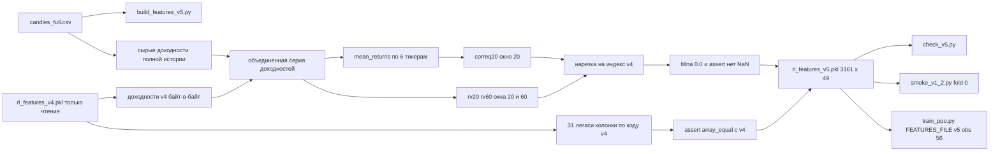

# План итерации v1.2 — ковариационные фичи (obs_dim 38 -> 56)

## Инварианты (проверяются на каждом шаге)

- Holdout (`fold 5`, 2026-06-16..2026-10-02) НЕ запускается ни в каком виде. Только печать
  границ фолдов (без прогонов env/обучения).
- Не изменяются: [`portfolio_env.py`](portfolio_env.py), 31 легаси-колонка, разметка фолдов,
  награда, `step` / `_get_obs` / `_apply_cap` / `reset` / `build_folds`.
- Не читаются на запись и не перезаписываются: `rl_features_v4.pkl`, `rl_prices_v4.pkl`,
  `optuna_ppo_v1_1.db`, `logs/train_ppo_20261026_195030.log`, `ppo_portfolio_v1.1_*.zip`.
  `rl_features_v4.pkl` открывается ТОЛЬКО на чтение для сверки байт-в-байт.
- Новые файлы: [`build_features_v5.py`](build_features_v5.py), [`check_v5.py`](check_v5.py),
  [`smoke_v1_2.py`](smoke_v1_2.py), `rl_features_v5.pkl`. Изменяется только
  [`train_ppo.py`](train_ppo.py): 3 конфиг-строки + шапка + явный `features_path` в двух
  внутренних созданиях `PortfolioEnv`. Никаких других правок.

## Ключевые технические решения

### 1. Как гарантировать байт-идентичность 31 легаси-колонки

Не переписывать формулы руками. В [`build_features_v5.py`](build_features_v5.py) импортировать
готовые примитивы из [`build_features_v4.py`](build_features_v4.py:29):

```python
from build_features_v4 import (TICKERS, FEATS, ATR_PERIOD, SMA_PERIOD,
                               VOL_NORM_WINDOW, GAP_DAYS, DATA_END, compute_features)
```

Файл [`build_features_v4.py`](build_features_v4.py:122) имеет `if __name__ == '__main__'`, поэтому
импорт не запускает запись артефактов. Затем повторить ровно ту же последовательность
шагов: `compute_features` -> пересечение индексов -> `is_weekend` -> сборка 31 колонки ->
`dropna()` -> мост через `GAP_DAYS`. Это даёт те же значения без дублирования формул.

Обязательный финальный гейт перед записью:

```python
v4 = pd.read_pickle('rl_features_v4.pkl')
assert len(features) == 3161
assert features.index.equals(pd.DatetimeIndex(v4.index))
assert np.array_equal(features.values, v4.values), 'легаси 31 колонка не совпала с v4'
```

Если assert падает — скрипт завершается с ошибкой и `rl_features_v5.pkl` НЕ пишется.

### 2. Окна считаются на полной истории, затем нарезаются

- Для `rv20/rv60`: по каждому тикеру берётся его ПОЛНАЯ серия из `candles_full.csv`
  (до пересечения индексов), `returns` считается на полной серии, rolling std — на полной
  серии, затем `.reindex(common).reindex(features.index)`.
- Для `correq20`: mean_returns строится на полном пересечении всех 6 тикеров (надмножество
  индекса v4, включает историю до 2014-08-19, если она есть у всех шести), rolling corr
  считается там же, затем нарезается на индекс v4.
- `rolling(..., min_periods=20)`; `std` — `ddof=1` (как штатный `rolling().std()` в v4);
  корреляция — `rolling(20, min_periods=20).corr(...)`.
- После нарезки: `fillna(0.0)` только для новых 18 колонок, затем
  `assert not np.isnan(new_block).any()`. Вырожденный случай `std == 0` даёт NaN в corr ->
  попадает в тот же `fillna(0.0)`, отдельная ветка не нужна (но проверить в отчёте счётчик).

### 3. Доходностная серия для окон: гибрид v4 + сырая история (РЕШЕНО — вариант A)

Формируется объединённая доходностная серия по каждому тикеру (индекс `full_idx` —
пересечение сессий всех 6 тикеров на полной истории, надмножество индекса v4):

1. Базовая серия — сырые `pct_change()` из `candles_full.csv` по всей истории тикера,
   `reindex(full_idx)`.
2. Затем строки, попадающие в индекс `rl_features_v4.pkl`, ПЕРЕЗАПИСЫВАЮТСЯ значениями
   из колонки `{T}_returns` файла v4 — побайтово теми же числами (мост 2022-03-24 там
   уже обнулён, и обнуление приходит именно оттуда, а не из ручной правки).

Окна `rv20 / rv60 / correq20` считаются по этой объединённой серии с `min_periods=20`.
Итог: на всех 3161 строках агент видит в `obs` и в окнах ОДНИ И ТЕ ЖЕ доходности.

`mean_returns` = `.mean(axis=1)` по шести объединённым колонкам (skipna=True): на индексе
v4 все шесть значений гарантированно есть. Строки, где после rolling набрано меньше 20
наблюдений, заполняются нейтрально (`correq20 -> 0.0`, `rv20/rv60 -> 0.0`).

Обязательный гейт: `np.array_equal(combined.loc[v4.index, f'{t}_returns'], v4[f'{t}_returns'])`
для всех шести тикеров — то есть вся 3161 строка доходностей совпадает с v4 байт-в-байт.

### 3a. Диагностика моста (в отчёт, для протокола)

Скрипт печатает значение СЫРОЙ доходности (до перезаписи значениями v4) на строке моста
2022-03-24 по каждому тикеру и `max|r|` — чтобы в протоколе было видно, насколько крупным
был выброс, который мы заменили на 0.0. Это только печать, в финальный pkl не попадает.

### 4. Порядок колонок и dtype

`31 легаси -> rv20(SBER,MGNT,PLZL,NVTK,LKOH,TATN) -> rv60(...) -> correq20(...)`; весь
DataFrame `float32`; 49 колонок, 3161 строка.

## Диаграмма потока



## Todo-план

Порядок исполнения, каждый пункт — отдельный проверяемый результат.

1. `build_features_v5.py`: импорт примитивов v4, пересборка 31 колонки, гейт
   `np.array_equal` с `rl_features_v4.pkl`, отказ писать при расхождении.
2. `build_features_v5.py`: блок новых 18 колонок (rv20/rv60/correq20) на полной истории,
   нарезка на индекс v4, `fillna(0.0)`, assert без NaN, `float32`, порядок колонок.
3. Прогон `python build_features_v5.py`, фиксация вывода (shape 3161x49, счётчик
   нейтральных заполнений, диапазоны corr/vol).
4. `check_v5.py`: 6 проверок из ТЗ с ненулевым кодом возврата при любом провале
   (размер/индекс, 31 колонка через `np.array_equal`, NaN/диапазоны, 6 границ фолдов,
   `obs.shape == (56,)`, 3 шага env + корректность `info`).
5. Прогон `python check_v5.py`, сохранение полного вывода для отчёта.
6. `train_ppo.py`: `VERSION = "v1.2"`, `FEATURES_FILE = 'rl_features_v5.pkl'`,
   `N_TRIALS = 25`, дополнение шапки (версия, дата, список изменений) + явный
   `features_path=FEATURES_FILE` в двух внутренних созданиях `PortfolioEnv`
   ([`train_ppo.py`](train_ppo.py:149), [`train_ppo.py`](train_ppo.py:325)), которые иначе
   подхватили бы дефолт v4. Больше ничего.
7. `smoke_v1_2.py`: PPO на fold 0, `total_timesteps=2000`, `seed=42`, obs из v5, без
   Optuna; проверка obs (56,), проход 100 шагов env, печать obs_dim / первых 10 obs /
   финальных весов, лог в `logs/smoke_v1_2_<stamp>.log` (правило AGENTS.md).
8. Прогон `python smoke_v1_2.py`, сохранение вывода.
9. Финальный отчёт: вывод `check_v5.py` целиком, список созданных/изменённых файлов, вывод
   смоук-теста. Полный Optuna не запускается.

## Наблюдения по рискам (без правок кода)

- [`train_ppo.py`](train_ppo.py:149) и [`train_ppo.py`](train_ppo.py:325) создают
  `PortfolioEnv(...)` без `features_path`, т.е. на дефолтном v4. Численно это эквивалентно
  (индекс v5 идентичен v4, легаси-колонки `_returns` байт-в-байт те же), но по решению
  пользователя `features_path=FEATURES_FILE` прописывается явно — чтобы ни одна точка
  пайплайна v1.2 не зависела от дефолта `portfolio_env.py`, который остаётся v4.
- [`portfolio_env.py`](portfolio_env.py:72) дефолт `features_path='rl_features_v4.pkl'`
  НЕ меняется: все скрипты v1.2 передают v5 явно.
- PPO с `total_timesteps=2000` и `n_steps=2048` соберёт один полный роллаут (2048 шагов)
  и остановится — это ожидаемо, предупреждения SB3 не являются ошибкой.
- `min_periods=20` при окне 60 означает, что первые 20 наблюдений `rv60` валидны, но
  нестабильны; это соответствует ТЗ и фиксируется в выводе скрипта.
- Optuna-база `optuna_ppo_v1_2.db` появится только при запуске `train_ppo.py` (Этап 1),
  не в рамках этой задачи.
- `mean_returns` для `correq20` — среднее по шести доходностям, а Equal-бенчмарк в
  [`portfolio_env.py`](portfolio_env.py:341) считается через `np.mean` по тем же шести
  доходностям следующего бара. Консистентно: корреляция меряется с тем же Equal, что и
  бенчмарк в награде/диагностике.
